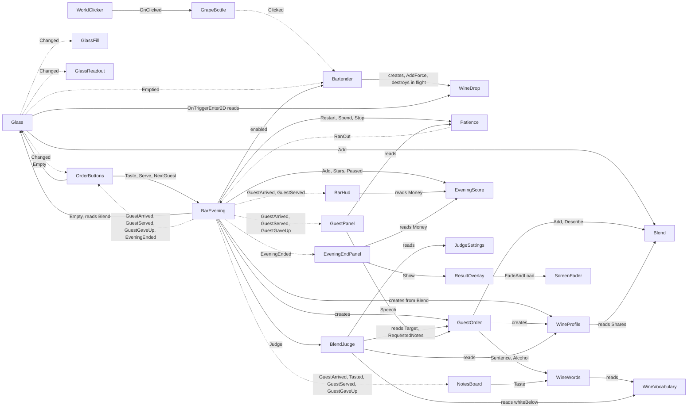

<div dir="rtl" lang="he">

# בר הבלנדים: ערב ראשון

לקוח מתאר במילים איזה יין הוא רוצה, ולא אומר מאילו ענבים. השחקן מוזג מהבקבוקים לכוס, טועם, מתקן ומגיש לפני שנגמרת ללקוח הסבלנות. בערב יש שלושה לקוחות.

מסמך העיצוב: [Vino-Blend-Bar](https://github.com/Game-development-Ariel/Vino-Blend-Bar)

## קישורים

* המשחק באיץ' (אפשר לשחק בדפדפן): [game-dev-ariel.itch.io/ex4-vino-blend-bar](https://game-dev-ariel.itch.io/ex4-vino-blend-bar)
* דיווח על שימוש בבינה מלאכותית: [AI_REPORT.md](AI_REPORT.md)

## איך מריצים

1. אחרי `git clone` מריצים `git lfs pull`, כי התמונות והצלילים שמורים ב-Git LFS.
2. ב-Unity Hub פותחים את התיקייה של המאגר, בגרסה 6000.3.25f1.
3. פותחים את הסצנה `Assets/Scenes/WineBar` ולוחצים Play.

הסצנה נבנית מקוד ב-[WineBarSceneBuilder.cs](Assets/Scripts/Editor/WineBarSceneBuilder.cs), והנתונים ב-[WineBarAssets.cs](Assets/Scripts/Editor/WineBarAssets.cs) (נכס שכבר קיים לא נדרס). אחרי שינוי בכלים מריצים `Tools > Rebuild Scene`. בנייה לדפדפן: `Tools > Build WebGL`. הבנייה יוצאת לתיקייה `../ex4-webgl-builds/ex4-vino-blend-bar`, מחוץ לפרויקט, כדי שלא תיכנס לגיט.

## איך משחקים

הכול בעכבר (או במגע):

* לחיצה על בקבוק מוזגת 10% מהכוס. מתחת לכל בקבוק כתוב איך הזן מרגיש, באותן מילים שהלקוחות משתמשים בהן.
* **Taste** מתאר את מה שיש בכוס, אבל עולה 5 שניות מהסבלנות של הלקוח. טעימה של כוס ריקה לא עולה כלום.
* **Empty glass** מרוקן את הכוס. **Serve** עובד רק כשהכוס מלאה (100%).
* אחרי ההגשה רואים ציון, מה היה גבוה או נמוך מדי, ומה הלקוח רצה. **Next guest** מביא את הלקוח הבא, ואחרי האחרון **See results** מראה את סוף הערב.
* **ניצחון**: ממוצע של 3 כוכבים (מתוך 5) לפחות בשלושת הלקוחות. הממוצע מעוגל לספרה אחת אחרי הנקודה, בדיוק כמו שהוא מוצג.
* **הפסד**: ממוצע נמוך יותר. לקוח שנגמרה לו הסבלנות עוזב בלי לשלם ומקבל 0.

## פיסיקה

| תכונה | איפה | קובץ |
|---|---|---|
| Rigidbody2D | כל מזיגה היא טיפת יין שעפה מהבקבוק לכוס | [WineDrop.cs](Assets/Scripts/Pouring/WineDrop.cs) |
| AddForce | הברמן זורק את הטיפה במהירות שמחושבת לפי נוסחת הזריקה, כך שתנחת בכוס מכל בקבוק על המדף | [Bartender.cs](Assets/Scripts/Pouring/Bartender.cs) |

הכוס היא טריגר ([Glass.cs](Assets/Scripts/Pouring/Glass.cs)): כשטיפה נכנסת היא בודקת איזה זן יש בה וכמה, ומוסיפה לבלנד רק את מה שנכנס עד 100%. טיפה שלא נכנסת לכוס נופלת ונהרסת אחרי 3 שניות (`lifetimeSeconds` ב-WineDrop). טיפות שעדיין באוויר כשמרוקנים את הכוס, או כשהלקוח קיבל את הכוס או עזב, נהרסות על ידי Bartender, כדי שלא ינחתו בכוס של הלקוח הבא.

## מבנה התיקיות

<div dir="ltr">

```
Assets/
├── Scripts/
│   ├── Wine/       GrapeData, Blend, WineProfile, WineWords, WineVocabulary
│   ├── Pouring/    GrapeBottle, Bartender, WineDrop, Glass
│   ├── Guests/     GuestRecipe, GuestOrder, BlendJudge, JudgeSettings, ServeResult
│   ├── Game/       BarEvening, EveningScore, Patience, BarEveningSettings
│   ├── Input/      IClickable, WorldClicker
│   ├── UI/         BarHud, GuestPanel, NotesBoard, GlassReadout, OrderButtons, GlassFill,
│   │               EveningEndPanel, ResultOverlay, ScreenFader, ButtonFeel, UiFactory, UiTheme, UiAnim
│   ├── Audio/      Sfx
│   └── Editor/     the tools that build the scene and the data
├── Data/           Grapes/ (8 grapes), Day1Settings (the guests of the evening),
│                   WineVocabulary (where the words change), JudgeSettings (the scoring numbers)
├── Prefabs/        WineDrop
├── Scenes/  Sprites/  Resources/  Settings/
```

</div>

`Game` מחזיקה את החוקים (מתי מנצחים ומפסידים), ו-`UI` מציגה. קוד המשחק לא מכיר את קוד הממשק: הממשק מאזין לאירועים של המשחק, ולא להפך. הכפתורים קוראים לפונקציות של BarEvening, אבל BarEvening לא יודע שיש כפתורים.

## יחסי המחלקות

כל האירועים כאן הם אירועים רגילים של C# (`event Action`). כל הרשמה לאירוע של C# (`+=`) נעשית ב-`OnEnable` ומבוטלת ב-`OnDisable`. המאזינים של הכפתורים (`onClick.AddListener`) נוספים פעם אחת ב-`Awake`, כי הכפתור והמאזין נוצרים ונהרסים יחד.

בתרשים: מלבן הוא מחלקה, חץ מקווקו הוא אירוע, וחץ רגיל הוא קריאה ישירה.

<div dir="ltr">



</div>

| אירוע | מי שולח | מי מקבל |
|---|---|---|
| GrapeBottle.Clicked | GrapeBottle | Bartender (מוזג) |
| Glass.Changed | Glass | GlassFill (גובה וצבע היין), GlassReadout (מה בכוס), OrderButtons (האם אפשר להגיש) |
| Glass.Emptied | Glass | Bartender (הורס את הטיפות שעדיין באוויר) |
| Patience.RanOut | Patience | BarEvening (הלקוח עוזב) |
| GuestArrived | BarEvening | BarHud (מספר הלקוח), GuestPanel (שם והזמנה), NotesBoard (טיפ), OrderButtons (כפתורי ההזמנה) |
| GuestServed | BarEvening | BarHud (הכסף), GuestPanel (התגובה), NotesBoard (הציון והמשוב), OrderButtons (Next guest) |
| GuestGaveUp | BarEvening | GuestPanel (משפט הפרידה), NotesBoard (מה הלקוח רצה), OrderButtons (Next guest) |
| Tasted (נושא את ה-WineProfile) | BarEvening | NotesBoard (הופך אותו למילים עם WineWords) |
| EveningEnded | BarEvening | EveningEndPanel (מסך הסיום), OrderButtons (מסתיר את הכפתור) |

## החלטות ארכיטקטורה

**1. מזיגה פיזיקלית במקום כפתורי פלוס ומינוס.** באב-הטיפוס שלנו היו כפתורי + ו- ליד כל זן, ומחלקה אחת גדולה (WineShopGame) שבנתה את כל המסך והחזיקה את כל המצב. עכשיו כל מזיגה היא טיפה שנושאת את הזן ואת הכמות, והכוס מוסיפה לבלנד רק את מה שנכנס אליה. ככה הבקבוק, הברמן והכוס לא מכירים זה את זה מעבר לטיפה. החלופה (להשאיר את הכפתורים) הייתה פשוטה יותר, אבל בלי שום פיסיקה ועם הרבה פחות תחושה של בר.

**2. שפה אחת ללקוחות ולטעימה.** [WineWords](Assets/Scripts/Wine/WineWords.cs) הופך מספרים למילים ("firm, grippy tannins"). גם הלקוח שמזמין וגם הטעימה משתמשים בו, ולכן מה שהלקוח אומר ומה שהטעימה מתארת תמיד באותן מילים, וזה בדיוק מה שהשחקן לומד. החלופה הייתה לכתוב את בקשות הלקוחות ביד, ואז היה אפשר בטעות לבקש "גוף מלא" כשהבלנד הנכון בכלל לא מלא.

**3. אירועים רגילים של C# ולא אירועים כנכסים.** כל אירוע כאן נושא מידע (ההזמנה, תוצאת ההגשה), ולכל המאזינים ממילא יש הפניה ל-BarEvening. אירוע כנכס היה מוסיף קובץ לכל אירוע בלי להוריד אף תלות.

**4. השופט הוא מחלקה רגילה.** [BlendJudge](Assets/Scripts/Guests/BlendJudge.cs), [Blend](Assets/Scripts/Wine/Blend.cs) ו-[WineProfile](Assets/Scripts/Wine/WineProfile.cs) הם מחלקות C# רגילות ולא MonoBehaviour. גם [EveningScore](Assets/Scripts/Game/EveningScore.cs) (הכסף והכוכבים של הערב). הם רק מחשבים, אין להם מה לעשות בסצנה, וכך קל להבין אותם בלי יוניטי. החלופה הייתה לעשות אותם MonoBehaviour על אובייקט בסצנה: אז רואים אותם ב-Inspector, אבל צריך לחבר כל אחד בבונה הסצנה, ואי אפשר לחשב ציון בלי סצנה פתוחה.

המספרים לכוונון (סבלנות, מחיר טעימה, תשלום, כמה כוכבים יש וכמה צריך) נמצאים בנכס [Day1Settings](Assets/Data/Day1Settings.asset), והזנים בנכסים ב-`Assets/Data/Grapes`. הספים של המילים (מתי יין "יבש", ומאיזה אחוז זן מרגישים את הניחוחות שלו) נמצאים בנכס [WineVocabulary](Assets/Data/WineVocabulary.asset), ומספרי הציון (הטווח והמשקל של כל תכונה, מתי הלקוח אומר "a little" ומתי "Perfect") בנכס [JudgeSettings](Assets/Data/JudgeSettings.asset). Day1Settings מצביע על שניהם.

## איך מוסיפים דברים

**לקוח חדש (המקבילה ל"אויב חדש" כאן).** מוסיפים שורה לרשימת guests בנכס [Day1Settings](Assets/Data/Day1Settings.asset): שם, בלנד וניחוחות. אין שינוי בקוד: מה שהלקוח אומר נבנה מהבלנד.

**זן חדש.** מוסיפים שורה ל-`Grapes()` ב-[WineBarAssets.cs](Assets/Scripts/Editor/WineBarAssets.cs) (שם, אדום או לבן, צבע, חמשת הערכים, שתי שורות רמז וניחוחות) ומריצים `Tools > Rebuild Scene`. הכלי יוצר את נכס ה-GrapeData ב-`Assets/Data/Grapes` ושם בקבוק על המדף, ארבעה בכל מדף, כך שזן תשיעי פותח מדף שלישי. כדי שמדף שלישי ייכנס למסך צריך להזיז את המדפים ב-[WineBarSceneBuilder.cs](Assets/Scripts/Editor/WineBarSceneBuilder.cs) (`TopShelfY`, `ShelfSpacing`). נכס GrapeData שנוצר רק מהתפריט (`Create > Wine Bar > Grape`) לא מקבל בקבוק בסצנה. החישוב של הבלנד והניסוח של הלקוחות עובדים על כל זן.

## סינגלטון ומשתנים סטטיים

אין סינגלטון.

| איפה | מה | למה |
|---|---|---|
| [WineWords](Assets/Scripts/Wine/WineWords.cs) | מחלקה סטטית | רק פונקציות שהופכות מספר למילים. אין בה מצב. הגבולות בין המילים (מתי יין "יבש") לא כתובים בה, הם בנכס [WineVocabulary](Assets/Scripts/Wine/WineVocabulary.cs) שהיא מקבלת |
| [Sfx](Assets/Scripts/Audio/Sfx.cs) | מחלקה סטטית עם AudioSource אחד ומילון של הצלילים שכבר נטענו | הקליק של Play again צריך להמשיך גם כשהסצנה נטענת מחדש. אין בו מצב של המשחק |
| [ScreenFader](Assets/Scripts/UI/ScreenFader.cs) | `FadeAndLoad` סטטית ודגל `isFading` | המסך השחור חייב לשרוד את טעינת הסצנה. הדגל מונע טעינה כפולה, והוא מתאפס לפני כל הרצה (`RuntimeInitializeOnLoadMethod`), גם כשיוניטי לא טוען מחדש את הקוד |
| UiFactory, UiAnim, UiTheme, ResultOverlay | מחלקות סטטיות של פונקציות עזר וקבועים | אין בהן מצב |

## מה השתנה לעומת מסמך השלבים

* במקום כפתורי פלוס ומינוס, לוחצים על בקבוק והיין נזרק לכוס. אי אפשר להוריד זן אחד, רק לרוקן את הכוס.
* בערב יש שלושת הלקוחות הראשונים של יום 1, כדי שהשלב יהיה קצר.

</div>
